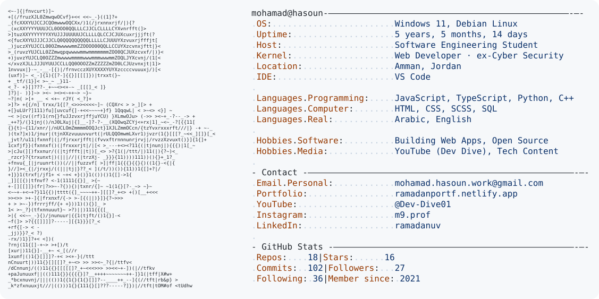

<!--
  Profile card inspired by Andrew6rant's GitHub README.
  To update your info or stats: edit CONFIG in generate_card.py (or swap ascii.txt),
  then run:  python generate_card.py
-->
<a href="https://github.com/CyberMan010">
  <picture>
    <source media="(prefers-color-scheme: dark)" srcset="dark_mode.svg">
    
  </picture>
</a>
